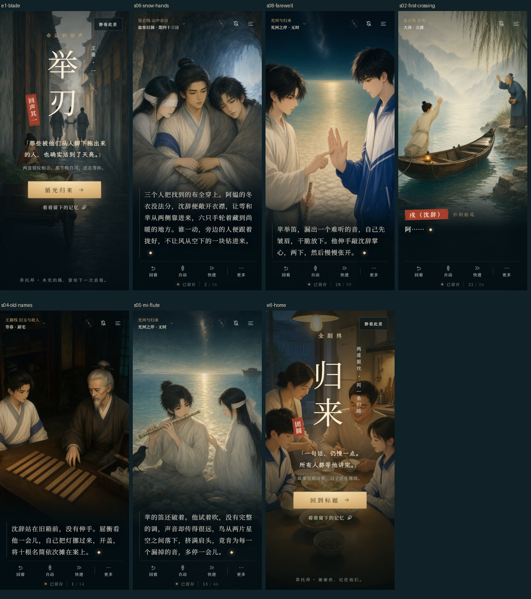
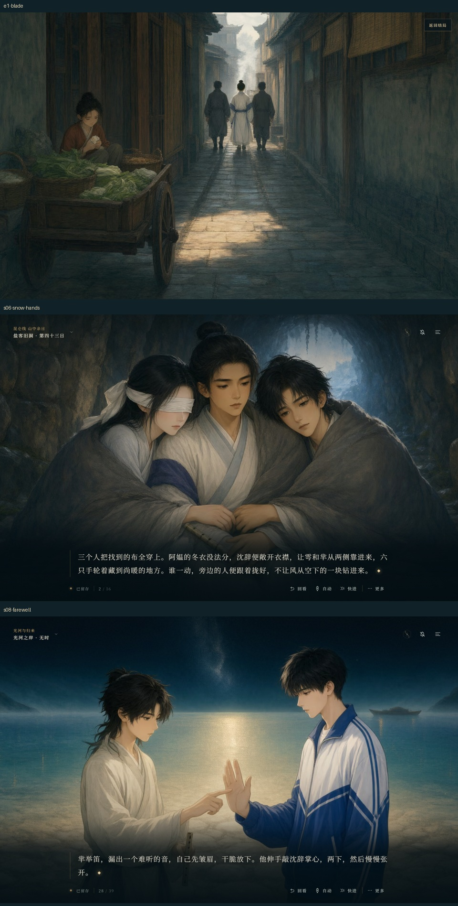

# 第一批美术精修 · 2026-11-14

本批交付 3 张重绘横幅 CG、7 张独立竖幅 CG。画风继续采用青黛、旧金与自然肤色的水彩厚涂；人物关系、手的接触和场景生活感优先于装饰。

手机成品与正文合成预览：

横幅成品与正文预览（举刃使用静看模式）：

| CG | 本批画面 | 原文与视觉验收 |
|---|---|---|
| 天亮以前 | 横幅重绘 + 竖幅 | `A-E1-2`：菜筐后是棠；白衣戌由两人带走，使用远背影；高墙、晨光与粥汽保留离别的代价。 |
| 不松 | 横幅重绘 + 竖幅 | `B-12-2:3:1`：戌的身体居中，蒙眼雩与芈从两侧靠进同一件冬衣；手拢在衣襟间，骨笛放低。 |
| 掌心的两下 | 横幅重绘 + 竖幅 | `终-1:22:2`：芈的食指接触现代沈辞掌心，另一手放低骨笛；原文叙述两下敲击，静态画面呈现其中一次接触。 |
| 河拐弯以前 | 新竖幅 | `B-1:21:0–22:3`：木舟与岸坡按纵深排列，戌、阿媪两人的脸、挥手与陶罐保留；竖屏取景略向岸上调整。 |
| 旧箱与断笛 | 新竖幅 | `A-6a:3:0–6:0`：双人侧脸、右手、油灯、开箱与十根窄木简同框；屈衡左手藏在袖内。刻痕不承担读字功能。 |
| 没吹完的一声笛 | 新竖幅 | `B-13:8:2`：芈吹笛、蒙眼雩倾听、近处停鸟和光河同框。 |
| 再添半碗 | 新竖幅 | 归来结局：母亲、父亲、沈辞与唐瑾同时可见；现代日常衣着，母亲持汤勺，保留普通厨房的暖光。 |

其余四幅既有横图沿用原构图，从 PNG 母版重新输出交付格式。横幅为 1376×768，独立竖幅为 768×1376；每张均提供 AVIF 和 WebP。

竖幅跟随屏幕形状，在宽高比不超过 3:4 时启用，手机横屏恢复横图，竖向平板也能使用新构图。窗口旋转会重新选图；竖幅 AVIF 失败后回退 WebP，两种竖幅均失败后显示横图，整张 CG 不可用时显示剧情背景。绘卷和下载继续提供完整横幅。

六个结局均可通过“静看此景”或 H 收起标题与墨幕，点击“返回结局”或再次按 H 恢复。举刃、归来的墨幕改为下方较深的渐变，保住新图的主体与暖光。后续仍可逐个结局细调标题位置。

制作使用本机 ComfyUI / Qwen-Image 2.1，13 次生成选出 10 张；掌心动作、姓名木简分别追加修订。真实提示词、种子、模型、任务编号、被淘汰版本记录和 SHA-256 位于 [生成来源](art-direction-1-sources.json) 与 [任务记录](art-direction-1-jobs.json)。PNG 母版与实际上传的参考文件均保存在仓库内，历史来源记录单独保留。

资源可通过 `python scripts/record-cg-sources.py` 重新核验，通过来源文件中的 `buildDelivery` 命令重建。`art:compress` 优先读取登记母版，独立竖幅不会被通用缩略图覆盖。

验证已完成：46 项单元测试；38 项 CG 浏览器检查；17 项立绘检查；资源完整性、原图/轻量模式切换和缓存更新检查。CG 检查覆盖 1440×900、390×844、360×740、844×390、820×1180，包含横竖切换、三种缺图情况与绘卷原画检查。截图经人工查看脸、手、道具和正文遮挡；浏览器模拟使用 Chromium，并非手机真机验收。

离线单文件已同步重建，95,090,204 字节（约 90.7 MiB），包含本批全部竖幅、27 张背景原图和 51 个音频文件。禁用网络验证图片解码、竖横竖切换、两种画质、存档导入导出、结局与归来均通过。原著正文和剧情触发区间保持一致。
