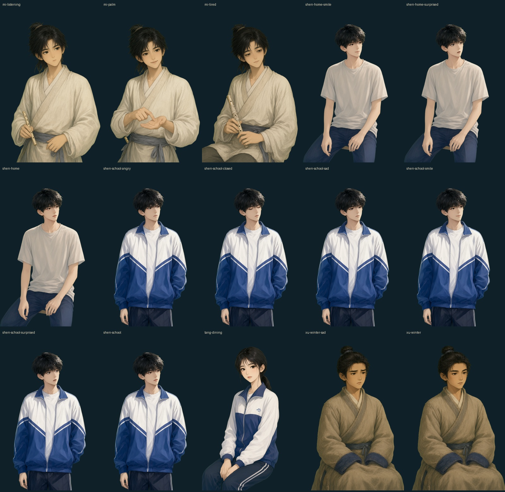
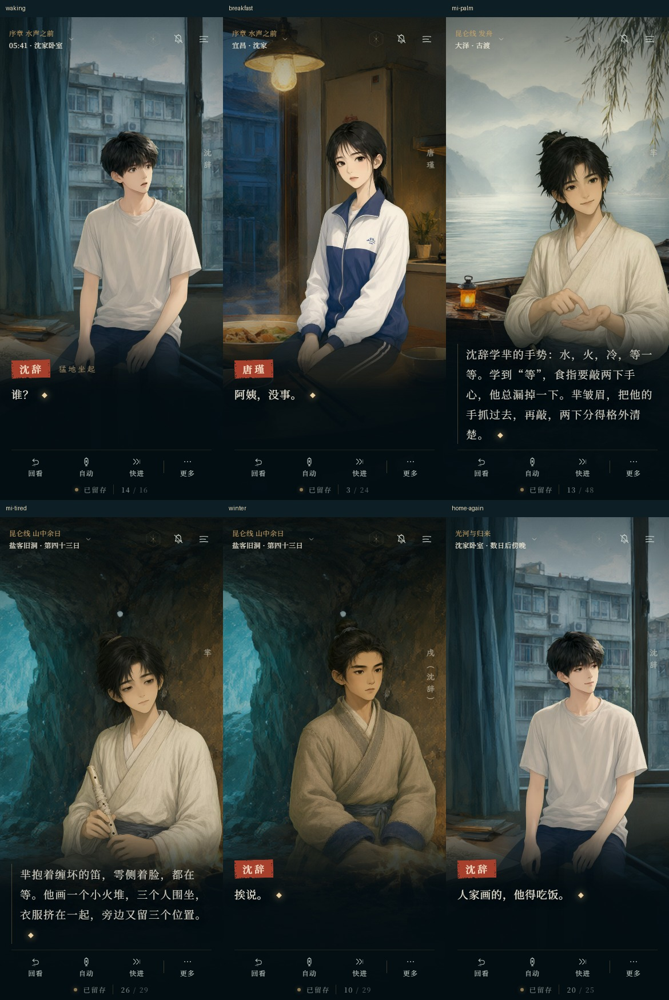
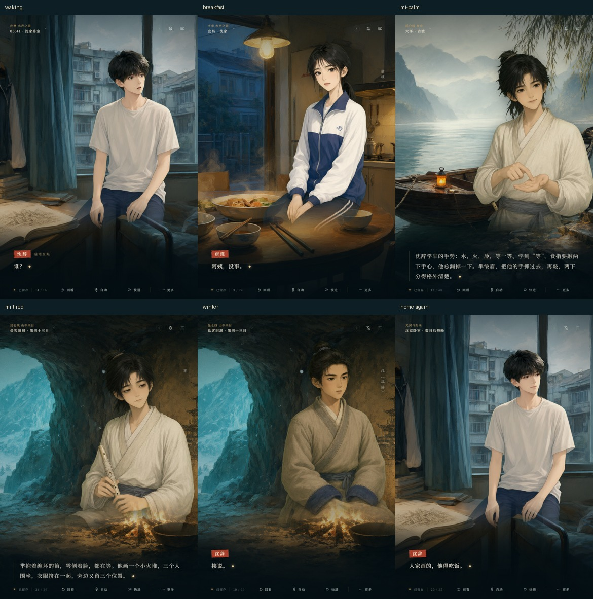

# 第二批美术精修 · 服装与交流姿态

本批使用本机 ComfyUI / Qwen-Image 2.1，制作 7 套服装或姿态，以及 8 张沿用既有面部表情的差分，共交付 15 张透明立绘。原有水彩厚涂、青黛与米白衣料、自然肤色继续保留。

| 人物 | 新资源 | 对应演出 |
|---|---|---|
| 沈辞 | 居家 T 恤坐姿：平静、惊、笑 | 开场惊醒、归来后的卧室画画、最后一顿家常饭。 |
| 沈辞 | 无书包校服：平静、笑、惊、怒、悲、闭眼 | 早餐、课堂、穿校服的梦境、归来的教室与走廊。保留已有演出指定的表情。 |
| 唐瑾 | 餐桌坐姿 | 早餐与归来晚饭；移除书包、挂件、本子，双手放在膝前。 |
| 戌的身体 | 米褐冬衣：平静、悲 | 留人线废亭、昆仑线山中与盐客旧洞；袖口接阿媪旧衣上的靛青布，双手藏进袖内。 |
| 芈 | 放笛倾听、掌心暗号、疲惫守候 | 教手势、收起笑容、荼离开、沉江后的安慰、寒夜画城。破笛在撞坏后的疲惫姿态中缠布，乌鸦不再固定停在肩上。 |

所有 7 套新服装或姿态均有实际可见的剧情使用位置。共 69 页明确选择新状态，详见 [逐页覆盖表](art-direction-2-coverage.json)；该数字不包含后续旁白保留立绘的页数，也不表示 15 张表情都已经各自获得独立演出标记。没有将 CG 覆盖下的隐藏立绘计作使用。

芈的掌心立绘呈现他以自己的掌心示范暗号；两个人真正的手指接触，仍由第一批精修的告别 CG 表现。疲惫版首稿仍像在微笑，已重修为半垂眼睑、平缓嘴角和放低肩膀；首稿和实际提示词均保留在来源记录中。

## 演出与设备

服装按当前身体和实际场景选择。沈辞借用戌身体时显示冬衣戌，竖排名字仍为“戌（沈辞）”；真正的戌在光河继续穿原来的白衣。冬衣尚在缝制、收进包袱时沿用原服装，外出赶路的现代沈辞仍保留书包。

归来篇在原句“回家，他把古图收进干燥的盒”切换卧室背景。此后的地点标注为“沈家卧室 · 数日后傍晚”，开场仍为“05:41 · 沈家卧室”；书签使用相同的地点规则。原文、段落 ID、选择与结局没有改写。

角色先解码对应服装再入场；同一个人的表情和姿态切换保留舞台节点。表情资源失败时先回退到同一服装的平静版，再尝试原立绘。迟到的请求不能恢复已经离场的人物。预加载也使用实际服装与姿态。

平板竖屏将人物上移并放大，让脸与掌心留在正文上方。手机横屏在掌心姿态右侧减轻墨幕，正文所在的左侧保留暗底。人物名继续显示。

手机正文实景：

平板竖屏实景：

横屏实景见 [横屏预览](art-direction-2-landscape.jpg)。

## 交付与来源

原始生成 PNG 为 832×1248，透明母版为 768×1152；提供桌面 AVIF / WebP 与 640×960 手机版，共 60 个运行图片文件。表情以已验收的面部母版配准合成，8 张差分的透明度及面部区域外像素与其服装底图完全一致。

- [真实任务、提示词、种子、参考图与 SHA-256](art-direction-2-sources.json)
- 生成原图：`resources/art-src/variants/generated/`
- 透明母版：`resources/art-src/variants/`
- 实际参考输入与淘汰首稿：`resources/art-src/references/art-direction-2/`
- 重建：`python scripts/process-actor-variants.py`，再用 `scripts/build-images.py --only` 输出所需资源。

离线单文件已重新打包，包含新立绘、未压缩背景与轻量背景两档。来源 PNG 不直接嵌入离线文件。

## 验证

完成 52 项单元测试、资源审计、旧有立绘与图片回退测试，以及离线图像、字体、音频和存档检查。新立绘用 1440×900、390×844、360×740、844×390、820×1180 五种视口检查脸、手、姓名、正文与布局，并验证延迟加载、表情缺失、整套服装缺失和原地换姿态。浏览器检查采用 Playwright；不是手机真机测试。
