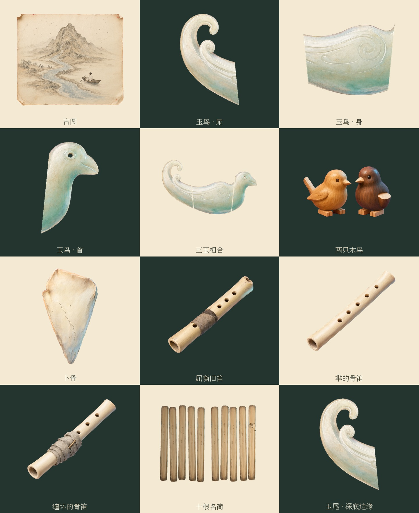
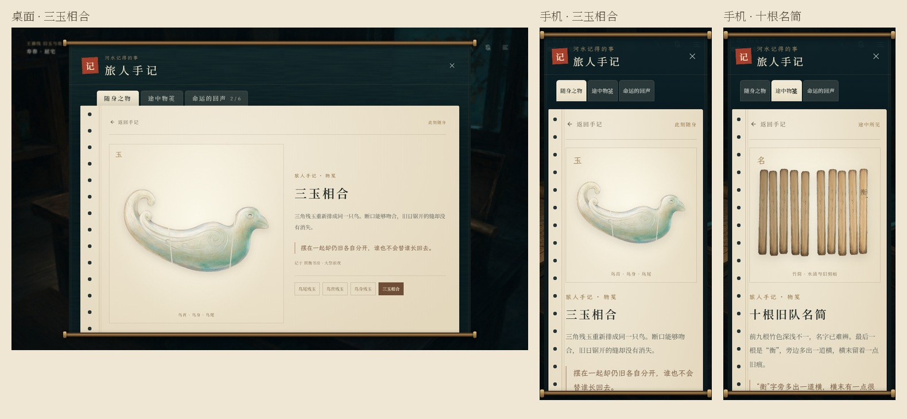

# 第三批：掌心之物

古图、残玉、木鸟与旧笛第一次在正文中出现时，现在可以点开「物笺」细看。手记新增「途中物笺」，只收录玩家实际读到的物件和形态；当前行囊仍随每轮旅途改变。

## 美术交付

本机 ComfyUI / Qwen-Image 2.1 共运行 9 次，采用 8 张生成源图，交付 11 张 1024 × 1024 透明 PNG 母版，以及各自的 AVIF、WebP。图像提示、种子、模型、任务编号和输出名见 [生成记录](art-direction-3-jobs.json)，源文件 SHA-256、参考图和加工说明见 [来源与加工](art-direction-3-sources.json)。

| 物件 | 母版与视觉约束 |
| --- | --- |
| 古图 | 茶色旧纸、暗红纸角、山与逆流的河、星斗、小舟和船尾白衣；不生成地图假字。 |
| 三玉 | 鸟尾、鸟身、鸟首、相合四幅。从同一只玉鸟切出三块，保留吻合的轮廓、相同羽纹、眼孔和锯缝。 |
| 两只木鸟 | 浅木一只尾歪，深木一只缺翅；保留手削刀痕。修正手记原有的「一只完好」。 |
| 卜骨 | 磨亮的骨边、两条方向相反的裂纹；金色亮纹与母版使用相同坐标，分别读取王裔、昆仑记忆。 |
| 屈衡旧笛 | 暗旧缠布，独立于芈随身的骨笛，归入「途中所见」。 |
| 芈的骨笛 | 完好、缠坏两幅。以完好源图编辑破损包扎，保留包扎外的管身、方向与指孔；物笺不会把芈的东西加入沈辞行囊。 |
| 十根名简 | 一根生成竹片排成十根，五根一组；前九名用难辨的旧刻痕表达，末根准确排入「衡」和独立的一横。未杜撰前九个姓名。 |

第一版木鸟的近侧翅膀仍完整、脚爪过于接近活鸟，已退回并编辑；初稿保存在 `resources/art-src/references/art-direction-3/birds-rejected.png`。卜骨原始生成图中偶然出现的一道中央裂缝，经局部修复后，重新刻入两条固定裂纹；加工与亮纹均可重建。



## 阅读与手记

- 25 个明确的原著段落提供可选入口，登记于 `src/data/relics.ts`。进入场景或提前获得场景级物品标记，不会显示未读图像。
- 物笺按七组旧物收录。三玉与芈的骨笛可切换已经见过的形态；没有未读形态的名称或预览。
- 「此刻随身」「途中所见」分别由当前行囊与已读记录决定。跨轮保留物笺，三玉实物仍须每轮亲自取得。
- 细看暂停自动阅读；关闭手记后沿用自动状态。浏览物件不会推进正文、改写选择或物品。
- 手机以单列展示，桌面和平板分栏。打开物件、切换形态回到页首；返回目录还原浏览位置和键盘焦点。
- Escape 先返回手记，再逐层退出。阅读界面在一帧绘制后恢复焦点，避免 `inert` 与隐藏状态尚未解除时丢失焦点。
- WebKit 缓存图片可能很早触发 `load`。图片状态按素材重新挂载，亮纹不会再被后执行的重置 effect 清掉。
- AVIF 失败切换 WebP；两种图都缺失时仍保留名称、正文与导航，不循环重试。

四个新增或原字体子集遗漏的汉字「式笺赭较」使用本地字体补片，合计约 5.3 KB。文楷补片的来源与版本已登记，复现直接使用仓库内的四字母版；SIL OFL 授权沿用 `public/fonts/` 中的授权文件。



## 验证

- 57 项单元检查，覆盖原著段落、分支、物品循环与新增物笺解锁规则。
- Chromium、WebKit 各 14 组物笺检查，含 1440 × 900、390 × 844、360 × 740、844 × 390、820 × 1180，检查读页解锁、形态切换、两线亮纹、自动暂停、焦点、溢出和图片回退。
- 原有 UI、回看、菜单、自动阅读、盖章、图片质量与网站缓存回归。
- 单文件离线版实际打开三玉与名简；181 张轻量图片、27 张背景原画、8 组字体面和 51 个音频全部内嵌，并在断网环境中解码验证。
- 资源审计：无缺失、无未引用的运行图片或音频。

浏览器证据与结果分别输出至 `artifacts/art-direction-3/chromium/`、`artifacts/art-direction-3/webkit/`，离线证据在 `artifacts/`。GitHub CI 保存检查截图。

## 重建

```powershell
python scripts/process-relics.py
python scripts/prepare-relic-fonts.py
python scripts/build-images.py --only prop-map prop-jade-tail prop-jade-body prop-jade-head prop-jade-joined prop-birds prop-bone prop-flute-old prop-flute-mi prop-flute-mi-broken prop-names
npm test
npm run build
npm run test:relics
npm run portable
npm run test:portable
```

本批母版用于手记与正文的细看入口，也可直接作为后续立绘、CG 的道具参考。既有 CG 内嵌的小道具尚未逐幅重绘；本批不以新母版替换整张剧情画面。
