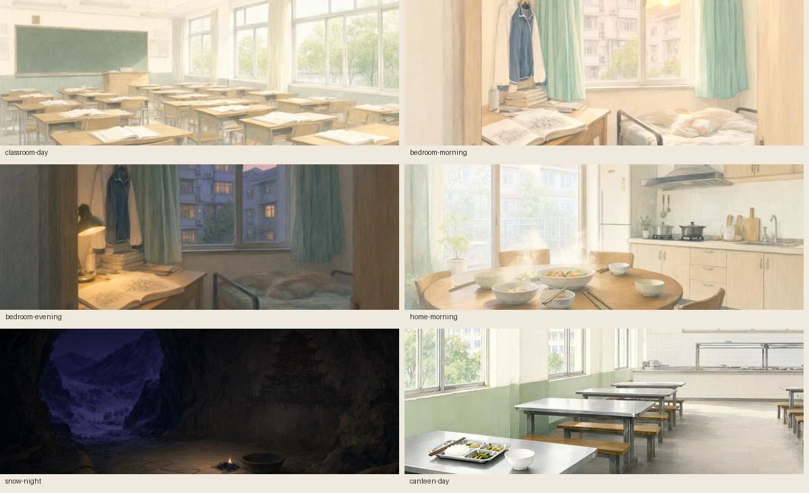

# 第四批：时段、长配乐与关键段落演出

六张时段背景让日常的晨光、午间和暮色与雪夜产生区别；三首约 146 秒的配乐减少慢读时重复开头的频率。开场、阿媪送行、雪夜和告别以少量逐页表情与自动阅读留白连接。81 场原文、页 ID、分支条件、结局和存档格式保持原样。

## 背景交付

| 资产 | 原文边界 / 用途 | 交付 |
|---|---|---|
| classroom-day | 普通白昼教室 | 替换原先仍有夜窗与亮灯的版本 |
| bedroom-morning | 0-1，手机再次亮起 07:12 之后 | 新增；与 05:41 灰蓝卧室区分 |
| home-morning | 0-2 早餐 | 新增；厨房自然日光 |
| canteen-day | 0-8 食堂至当晚沈家之前 | 新增；不再使用教室代替食堂 |
| bedroom-evening | 终-4:12:4 起，回家画画 | 新增；窗外暮色、桌边灯光，保留居家服 |
| snow-night | B-12-1:18:1 火光低下去，至下一场天亮 | 新增；暗蓝洞口与极少余烬 |

六张均由本机 Qwen-Image 2.1 制作，前五张参考原背景编辑，食堂独立生成。源 PNG 与所用参考图在 `resources/art-src/`；实际提示、种子、任务 ID、输出文件及 SHA-256 见 [生成记录](../art/art-direction-4-jobs.json)。本批没有用滤镜冒充新时段。

`scripts/process-time-of-day.py` 导出与源 RGB 像素逐点相同的无损 WebP，并验证解码结果；AVIF、轻量 WebP 与缩略图独立导出。原画登记总数从 27 增至 32。六张像素验收结果见 [背景记录](../art/art-direction-4-backgrounds.json)。

另修复 0-7 梦醒后仍停在沉江祠的问题；地点显示为“沈家卧室 · 黎明前”，不为原文补写具体时间。B-12-2 的合衣 CG 保留到最后一页，背景时段映射在天光进入时恢复；该页不计作夜背景或新立绘的可见使用。

## 三首长主题

| 主题 | 游戏内时长 | 处理后响度 / 真峰值 |
|---|---:|---:|
| 把船撑向远方 | 146.842 秒 | -18.13 LUFS / -2.23 dBTP |
| 未说完的一声笛 | 146.000 秒 | -18.13 LUFS / -2.26 dBTP |
| 光河上的名字 | 146.471 秒 | -18.25 LUFS / -2.26 dBTP |

ACE-Step 1.5 在本机生成三份 150 秒 FLAC 母带，再作一小节等功率首尾交叠、双遍响度处理，输出 44.1 kHz 立体声、192 kbps MP3。母带留在忽略的 `artifacts/audio-masters/*-long.flac`，不覆盖旧母带。

本批沿用对应主题的音色、速度和调性重新作曲，没有输入旧曲音频，也不声称复用了旧版旋律。历史短版提示保存在 `audio-prompts.json`；新提示、实际种子、任务 ID、源校验和见 [音乐任务](../art/art-direction-4-music-jobs.json)，响度、循环接点与运行文件校验和见 [加工记录](../art/art-direction-4-audio.json)。独立复现命令为 `python scripts/process-long-score.py`，只替换这三首及其清单记录。

主题目录仍为 11 首，运行音频仍为 51 个。相同主题跨页继续播放，三个原有告别静默节点继续生效。Web Audio 的 48 MiB 解码缓存为软限额；正在播放和交叉渐变的音频会保留，单条长曲解码约 50 MiB，切走后可回收。

## 逐页演出

本批增加 10 处表情注释与 9 处明确在场注释，不推断记忆中提及的人物，也不使用服装中尚未交付的表情。

| 页面 | 原文依据 | 画面 |
|---|---|---|
| 0-1:8:0 / 8:1 | 惊醒后逐一确认自己的脸与手 | 沈辞居家服，惊魂未定 |
| B-1:17:0 | “没忍住，笑出了声” | 借身的戌微笑 |
| B-1:20:2 | 阿媪到岸边，抱小罐伸手 | 阿媪在场；随后交给原有送行 CG |
| B-1:22:4 | 送行后接过干布擦脸 | 借身的戌悲伤 |
| B-12-1:3:1 | 雩听破笛声忍不住笑 | 蒙眼雩的微笑 |
| B-12-1:18:1 / B-12-2:3:0 | 火光低下去、已没有新脚印 | 戌冬衣悲伤差分 |
| 终-1:5:0 | “没拉住你” | 沈辞借身阶段的悲伤表情 |
| 终-1:8:2 | 戌接过木鸟，笑了一下 | 真正的戌微笑，名字保留 |
| 终-1:22:4 | 雩最后过来，记住眉尾 | 雩在场，平静 |
| 终-1:27:0 | 笑着说完后让出前路 | 延续雩的微笑 |

`actorForBeat` 只在显式在场页接受旁白表情注释。13 处自动阅读留白在全文显现后增加 450–1400 毫秒，总阅读停留仍不超过 9 秒；手动继续、隐藏界面与已读快进不增加等待。

桌面 / 手机实机审阅：[晨间卧室](art-direction-4/morning.webp)、[雪夜余烬](art-direction-4/embers.webp)、[光河告别](art-direction-4/farewell.webp)。

## 离线交付

新增原画与长配乐令完整单文件达到约 108 MiB，超过 GitHub 的单文件限制。仓库版现在是约 19 MiB 的 `异托邦.html` 加同目录 `离线资源/` 下四个不超过 24 MiB 的经典脚本数据文件。两档画质与全部 51 个音频都保留；`file://` 直接打开，不依赖 fetch、服务器或 ComfyUI。资源缺失时显示中文恢复提示。

`npm run portable:single` 另生成真正完整的单文件到忽略的 `artifacts/portable/异托邦-单文件.html`。CI 验证两种版本并保存该完整文件。分片清理只处理上一份本工具清单中的已知文件，不递归删除目录。

## 验证

`npm test` 验证全部剧情分支、时段边界、衣服与显式反应、长主题身份、告别静默；`assets:check` 审计 32 张原画和全部运行资源。`test:scene-direction` 在桌面与手机验证 24 处实际构图、原画失败回退、跨页时段切换以及自动 / 手动阅读时序，支持 Chromium 与 WebKit。

离线回归在断网浏览器验证全部图像、八份字体、51 个音频实际解码、两档画质刷新、存读档、导入导出、手机 CG、物笺和终章入口；仓库版额外验证分片哈希、体积与缺失提示。原有立绘、移动阅读、声音手势、听水集、界面音效和缓存回归继续执行。结果摘要与审阅图保存在同名目录。

第三批 PR #10 已合并，离线刷新修复 PR #11 全绿后合并；main 发布运行 `43590158371` 成功，线上入口和第三批玉器文件已核对。第四批在独立分支提交 PR，待用户确认后合并。
