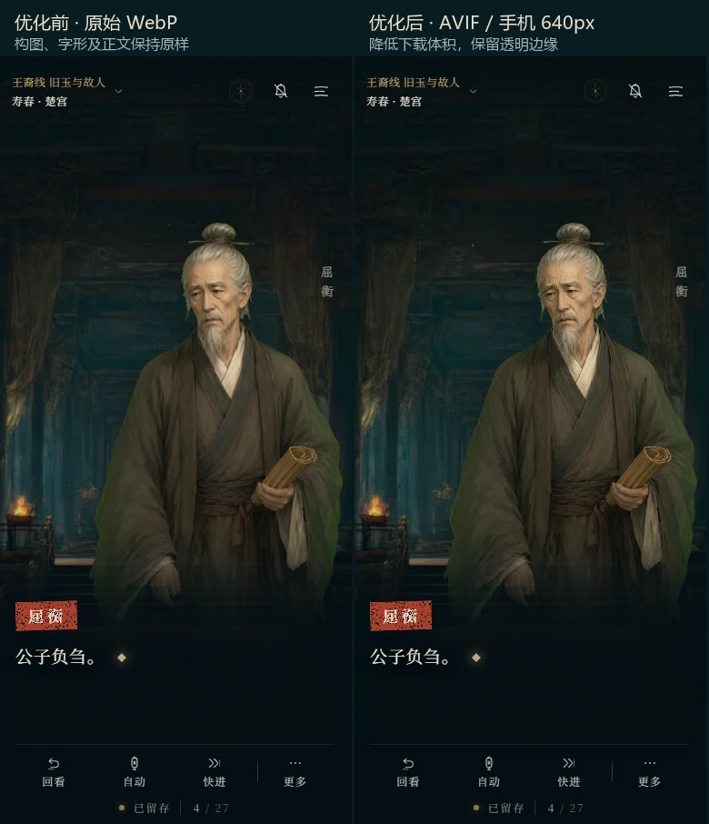
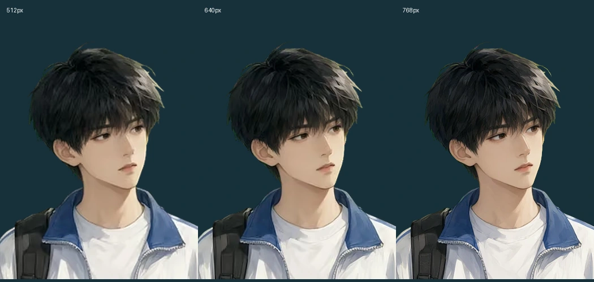

# 第二批性能优化验收

基线：`e0fbe9b`（PR #4 已合并、上线）。分支：`perf-1`。结果在本机 Windows、Playwright 1280×800 上测量；4G 为 85ms / 9Mbps，Fast3G 为 562ms / 约 1.44Mbps。测试均使用独立模拟存档，不访问玩家数据。

## 改动

- B1/B3：27 张背景与 14 张在用立绘增加 AVIF；原始 WebP 母版留在 `resources/art-src/backgrounds/`，发布的 WebP 回退重新压缩。`<picture>` 和背景 `image-set` 使用同一格式检测结果，预加载跟随实际选择；缺失 AVIF 时可回退 WebP。图片初始 `src` 与预加载一致，避免 Windows WebKit 在手机上额外下载桌面图；尺寸切换仍由 `<source>` 正确选图。
- B2：手机立绘改为 640×960。512×768 在 DPR3 对比中发丝偏软，因此采用较大档位，AVIF 每张不超过 40KiB、WebP 不超过 60KiB；较原建议的 30/45KiB 放宽预算以保留细节。人物志使用相同手机资源。
- B4：Service Worker 在首屏之后安装，支持 `/heterotopia/` 子路径。HTML 优先联网；版本化程序、字体、图片及完整音频复用缓存，Range 从完整音频切片，206 不入缓存。新版本显示“刷新 / 稍后”，不会自动打断阅读。保留当前及上一代缓存，兼顾仍打开的旧页面。
- B5：首页常规字形、场景标题和正文使用互不重叠的 Unicode 范围；首页半粗仅保留按钮用字。保留原始字重与轮廓，手写体在进入阅读时预热。OFL 授权继续随包分发。
- B6：首页只依赖 81 场的元信息，剧情 JSON 按需加载，空闲时预取；设置、绘卷、人物志、听水集和回看按需加载。点击启程/续梦时显示准备状态，优先解码当前画面和最近立绘。下载失败保留首页、设置和旧存档，并提供刷新重试。离线版另构建为完整单一脚本，不产生网络 chunk。
- B7：资源审计覆盖动态世界表与静态引用。21 个未使用导出共 2,066,793 字节移入 `resources/art-src/`，包含 hero PNG、旧立绘和未用人物缩略图；不是删除母版。原著下载继续提供。既有本机 `public/audio.zip` 保留在原处，排除在发布包之外。

## 资源量

| 项目 | 优化前 | 优化后 |
|---|---:|---:|
| 27 张运行背景 | 6,020,828 B WebP | 1,888,762 B AVIF / 2,524,730 B WebP |
| 14 张在用立绘 | 1,317,128 B WebP | 586,295 B AVIF |
| 手机 14 张立绘 | 使用桌面版 | 463,193 B AVIF / 760,246 B WebP |
| 首页字体 | 773,816 B | 46,940 B（当前首页及序章续梦） |
| 首页关键 JS，Vite gzip | 225.03 KB | 107.37 KB，含 React 与图标 |
| 单文件离线版 | 42,345,503 B | 37,059,933 B（减少 5,285,570 B） |

首页以外的存档地点可能额外请求 37,952 B 场景标题字体；仍远低于 200KB 字体预算。构建没有超过 500KB 的 chunk。最终 `dist/` 为 31,744,102 B，较基线已跟踪的发布内容约减少 1.82MB；不把本机未跟踪 ZIP 的排除计入节省。体积明细见 [images.json](perf-1/images.json)、[fonts.json](perf-1/fonts.json)、[build-sizes.json](perf-1/build-sizes.json)；审计前后见 [asset-audit-before.json](perf-1/asset-audit-before.json)、[asset-audit.json](perf-1/asset-audit.json)。本简报原有的 28 张 / 7.58MB 包含统计口径差异；这里按当前运行用背景逐文件核对。

## 冷启动网络实测

| 网络 | 首页 load 前 → 后 | 字体就绪前 → 后 | 首次立绘 ≥95% 前 → 后 |
|---|---:|---:|---:|
| 无限速 | 63 → 54ms | 157 → 181ms | 399 → 421ms |
| 4G | 455 → 334ms | 1432 → 542ms | 662 → 394ms |
| Fast3G | 2566 → 1926ms | 8367 → 3015ms | 2052 → 417ms |

**这些立绘数字从点击正文翻到第一句人物台词开始，不能当作从点击“续梦”起的总等待。** 优化后先准备剧情与当前画面；本轮 Fast3G 点击续梦到可读为 2349ms，至人物完整显示共 2817ms；4G 分别为 813ms / 1263ms，无限速为 147ms / 634ms。报告单独记录这两段，不用预取等待掩盖下载延迟。4G 点击人物台词前资源已加载完成。

首页从 9 次请求 / 1,184,572 B 降为 8 次 / 223,706 B，传输量减少约 81%。当前 Fast3G 的 load 1926ms、字体 3015ms，略高于简报的 1800/3000ms 目标。尚未宣称这两项达标。前后测量脚本一致、无人工预取等待，原始结果见 [performance-before.json](perf-1/performance-before.json)、[performance-after.json](perf-1/performance-after.json)。无网络限速数据包含本机调度开销，应以量级和冷网结果判断。

## 缓存与兼容性

`test:cache` 使用临时持久化浏览器，HTTP 响应设为过期，Chromium 还显式禁用 HTTP cache；不是只测试同一标签页重载。再次访问首页，Chromium/Firefox 只有 1 个 HTML 网络请求，其余资源由 Service Worker 返回。本机 Windows WebKit 会产生 2 个 HTML 请求，资源全部命中 Service Worker；这里保留并披露这项引擎差异，不把它记成“≤1 请求”达标。

缓存测试还覆盖断网导航、按需剧情、保存位置、音频前缀/后缀 Range 与 416、连续两次显式更新、旧缓存清理和紧急注销。更新后不会更改 `localStorage` 存档。当前 WebKit 测试环境不支持 AVIF，核对 WebP 回退；Chromium/Firefox 验证实际 AVIF 解码和 alpha。Windows WebKit 不是 iOS 真机 Safari。本轮持久化重开字体就绪为 Chromium 746ms（Fast3G）、Firefox 324ms、WebKit 11376ms（后两者未限速）；WebKit 的本机启动仍明显偏慢，不能据此承诺 Safari 二次启动速度。各引擎原始响应与结果见 [validation.json](perf-1/validation.json)。

## 验证

- 26 项单元测试：全部剧情分支、原文无损、场景元信息、并发剧情加载、图像预加载回退及存档兼容。
- 三引擎阅读交互、立绘、通用浏览器布局、图片/剧情失败检查；音频测试遵循现有 Web Audio / 原生媒体 / 静默回退能力。
- 单文件断网检查：82 张嵌入 WebP、6 组字体声明、51 个实际解码音频，存读档、导入导出、选择与归来；零 HTTP 请求。
- CI 追加图片回退、真实缓存、离线包构建与断网检查。原有共享 CI 帧时记录策略保留，本机 Chromium 仍执行 250ms 恢复 / 300ms 换人门限。

三引擎各通过 12 项交互、11 项立绘及 5 项缓存检查，通用布局、音频与图片失败检查的原始结果一并保存在 [validation.json](perf-1/validation.json)。最终本机 Chromium 严格检查：旁白恢复 205ms（≤250ms），缓存换人 254ms（≤300ms）；独立网络复测中旁白恢复 210ms，原节点保留。Firefox/WebKit 仅记录帧时，未用其数值宣称满足 Chromium 门限。CI 构建与离线包检查见[本分支 Actions](https://github.com/wujikei/heterotopia/actions?query=branch%3Aperf-1)，以 PR 最新提交的状态为准。

## 画面检查





没有生成新画面或声音；没有改原著剧情、分支、存档结构、`Asia/Shanghai` 时区。

## 发布、回退及缓存故障恢复

开工前：`pre-perf-1` 与 `backup/pre-perf-1`；交付：`perf-1-ready` 与 `backup/perf-1-ready`。用户确认合并后，打 `v-perf-1` 与 `backup/perf-1`，等待 Pages 部署通过。一般代码回退用 GitHub revert PR，避免 force push。

若上线后缓存阻止正常更新，在 **同一个 `public/sw.js` URL** 发布如下恢复 worker 并部署；不能只删掉 worker 文件，否则旧客户端仍受旧缓存控制。

```js
self.addEventListener('install', () => self.skipWaiting());
self.addEventListener('activate', event => event.waitUntil((async () => {
  const prefix = 'heterotopia-' + encodeURIComponent(new URL(self.registration.scope).pathname) + '-';
  await self.clients.claim();
  await Promise.all((await caches.keys()).filter(key => key.startsWith(prefix)).map(key => caches.delete(key)));
  await self.registration.unregister();
})()));
```

恢复 worker 不修改 `localStorage`，不清理其他站点缓存，也不强制重载正在阅读的页面。已打开的页面可在下次访问后退出旧缓存；紧急时可在浏览器开发者工具 Application → Service Workers 对该站点注销，**不要清除站点全部数据**，否则存档也会被删除。恢复完成后，再部署修复后的正常 worker。
