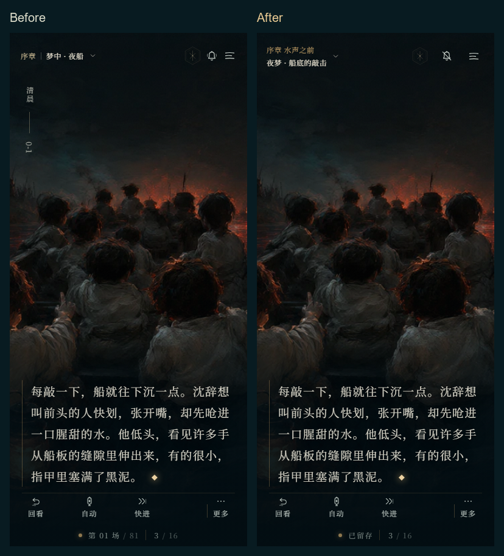

# 第一批交互修复验收

基线：`73ae78b`，分支：`codex/ui-fix-1`。验收日期：2026-11-13（北京时间）。

本批处理移交报告 #1、#2、#6、#7、#8、#9、#10、#13、#14、#16、#17，并连同回看排版、背景正文透光与菜单滚动一起处理 #18、#19、#22。

## 阅读与存档

- Esc 从子页返回上一层，最后关闭小憩菜单；标题旁有返回入口，右上角关闭直接回阅读。鼠标操作后，空格与 Enter 恢复阅读；键盘 Tab 仍可操作按钮，焦点限制在弹窗内。
- 书签删除第一次只显示红色确认态，第二次才移除；切换书签、标签或关闭页面会复位。删除失败时保留原存档。
- 回看支持滚轮向上、PageUp、左方向键。当前场景、本次访问、最近一次选择之后的连续历史句子可点击重读；选择之前及其他场景的条目保留为只读。物品、选择、轮次与跨路线记忆继续保留，存档结构仍为 version 1。
- 手动翻页增加 180ms 连点保护；章节卡结束后才开始第一句打字，副标题采用实际画面地点。已读快进显示整句，到未读处停止。
- 新增数字键选择、A 自动阅读、按住 Ctrl 已读快进、首次阅读提示与完整快捷键说明；读屏区域一次提交完整台词。

## 画面与触控

- 章名与当前地点合并到左上，移除内部场景编号，底部仅保留留存状态和本场页码。
- 纸签悬停时抬起、透出暖光与淡印，其他纸签降亮度；减弱动态设置继续有效。
- 顶栏、标题页入口、删除与关闭按钮至少 44px。窄屏“更多”操作分两行，修复设置与收起重叠、隐藏按钮越界。
- 手机标题页避开顶栏；横屏采用左右布局。弹窗打开时背景正文暂时隐藏；通知在卷轴内预留位置，避免覆盖书签。
- 原著、路线引擎、存档结构、时区、美术和音频资产保持基线内容；本地离线 HTML 已按本次界面重新打包。

## 验证结果

| 检查 | 结果 |
| --- | --- |
| `npm test` | 22/22，通过；新增 5 项安全重读测试 |
| `npm run build` | 通过 |
| `npm run test:interactions` | Chromium、Firefox、WebKit 各 12/12，通过 |
| `npm run test:browser` | 三引擎通过：桌面、手机、平板、横屏及存档、设置与资料页 |
| `npm run test:audio` | Chromium、Firefox 音频播放、通道、试听及快进回归通过；Windows WebKit 无 Web Audio，静默阅读与下载分支通过 |
| `npm run portable` / `npm run test:portable` | 通过；断网下 102 张图片、3 份字体、51 个音频均可读取，51 个音频实际解码成功 |

音频与离线脚本同步采用两轮 UI 改版后的按钮名、文楷字体与人物志结构；翻页验证遵循新连点间隔，播放恢复等待实际进度前进。

测试使用独立的临时浏览器与模拟进度，没有打开玩家浏览器或修改真实存档。以上为自动化浏览器验证，未代替手机实机、读屏软件和人工试听。

## 截图

同一段正文，左侧为改动前，右侧为本批修复后：

320px 窄屏展开“更多”，全部按钮保持可点击：

手机横屏标题页：

## 回滚与交付

改动前：`v-before-fix-batch-1`、`backup/before-fix-batch-1`，均指向 `73ae78b`。

本批完成：`v-ui-fix-1-ready`、`backup/ui-fix-1-ready`，指向本批提交。代码通过 PR 审阅后，再由用户明确确认合并；推送工作分支不触发 Pages 发布。合并后可用 `git revert -m 1 <本批合并提交>` 撤销本批，保留后续历史。
