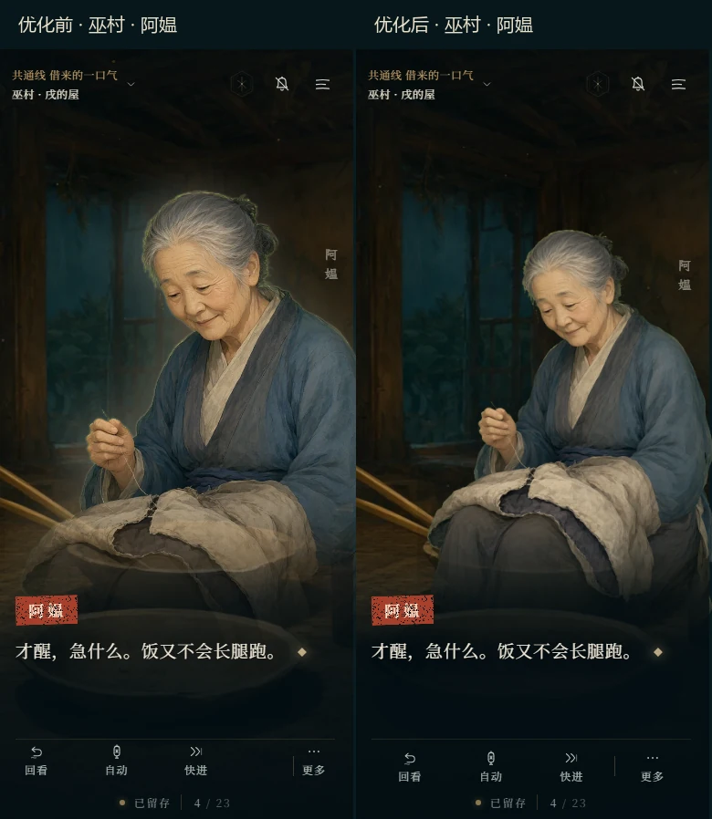
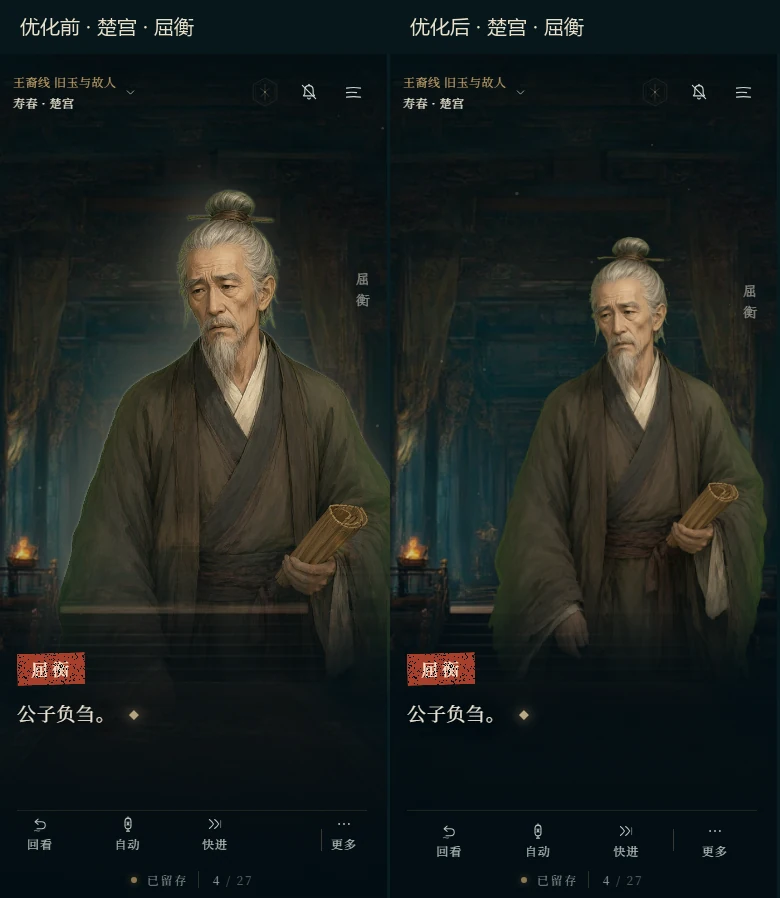
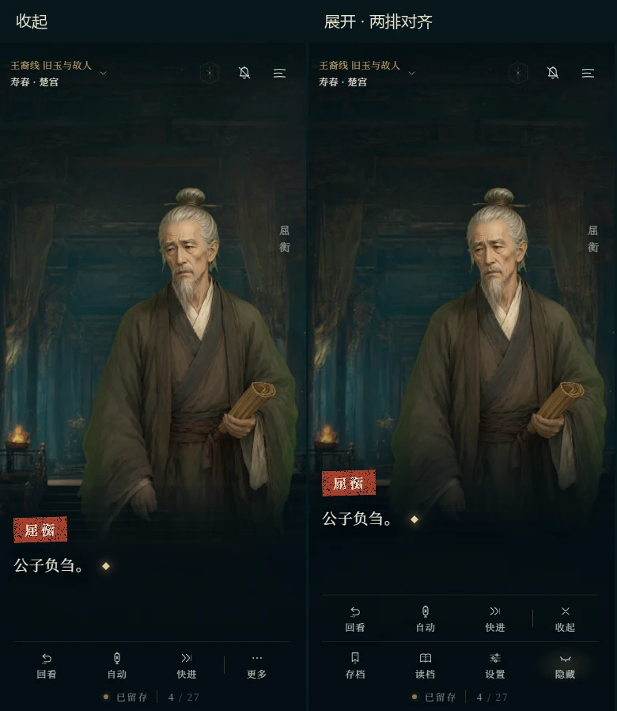

# 第二批交付：立绘与阅读体验

基线 `2367601`，分支 `ui-fix-2`，2026-11-13，北京时间。对应 BRIEF-2 批次 A。

## 结果

- A1：背景与立绘共用按 URL 缓存的解码预加载；读档也会执行。先加载当前背景和最近的说话人，再加载本场与下场资源，最后串行闲时预取；省流量时跳过全体立绘的闲时预取。没有 cast 标记的序章也根据实际说话人准备图片。
- A2：独立人物层保留仍在场的角色；旁白时稍暗，说话时恢复；新人物解码后交叉淡入。首次 400ms、换人 220ms；超过 1.5s 才完成加载时采用较短淡入。快进与减弱动态直接切换，迟到请求无法复活旧人物，缺图时继续阅读。借身和归还身体的规则保持兼容。
- A3–A4：人物下沿最后约 20% 渐隐，消除从胸口开始的透光；降低轮廓光、加入轻微场景色温。手机人物宽 86vw、高不超过 62dvh，保留持简的手和背景，正文背后加深墨雾。
- A5：窄屏采用四列操作，两排横坐标、宽度一致；收起的操作不占位。按钮至少 44px。
- A6：书签图、地点和摘句根据保存的那一页生成；梦船与卧室可以正确区分，旧页码回退。存档结构兼容现有 version 1，日期继续使用 Asia/Shanghai。
- A7：浏览器、交互、立绘与音频检查自动启动并关闭预览服务；保留 VN_TEST_URL。PR 和 main 构建均执行 Chromium 交互及立绘测试，通过后 main 才发布。章节卡测试用受控时钟验证暂停打字，适应软件渲染较慢的浏览器。

原著、路线引擎、公共美术与音频文件继续采用基线内容；本地单文件 HTML 已重新打包。

## 测量

同一台 Windows、本地 Vite preview、Chromium 1280×800、冷缓存；4G/Fast3G 参数与简报一致。从实际点击计时，立即翻页，包含下载耗时。原始记录见 [优化前](ui-fix-2/performance-before.json)、[优化后](ui-fix-2/performance-after.json)，复现：`npm run test:perf -- 标签`。

| 网络 | 首图加载完成：前 → 后 | 点击到 95% 可见：前 → 后 | 首页字体就绪：前 → 后 |
| --- | --- | --- | --- |
| unlimited | 35 → 17ms | 677 → 436ms | 141 → 144ms |
| 4G | 346 → 261ms | 681 → 646ms | 1401 → 1436ms |
| Fast3G | 1864 → 1798ms | 1864 → 2049ms | 8383 → 8368ms |

首页请求数均为 9。旁白后再次说话由 **730ms → 244ms**，实际 DOM 节点从卸载重建变为保留。

Fast3G 冷缓存立即翻页仍包含网络下载，未达到简报的 ≤550ms 总耗时目标；图片到达后有完整淡入。首页字体和资源体积由后续 perf-1 继续处理。脚本中的 authored 统计是按场景扫描的机会计数，不能替代全剧浏览器挂载测量；这里报告实际验证的旁白往返。

另一次三引擎交互测量（浏览器帧内计时）：

| 引擎 | 同人物恢复说话 | 缓存后换人 |
| --- | --- | --- |
| chromium | 237ms | 272ms |
| firefox | 211ms | 233ms |
| webkit | 338ms | 342ms |

性能门限在本机 Chromium 上断言；各引擎均检查 220ms CSS 过渡。共享 CI 采用 `VN_TEST_TIMINGS=record` 记录帧时，继续验证节点、交叉淡入、解码、缺图和触控等功能；其机器负载不用于判定本机性能回归。Windows WebKit 的帧调度更慢，以上不是 iPhone 实机数据。

## 验证

| 检查 | 结果 |
| --- | --- |
| npm test / npm run build | 25 项单元测试及构建通过 |
| test:sprites | Chromium、Firefox、WebKit 各 11 项通过 |
| test:interactions | 三引擎各 12 项通过 |
| test:browser | 三引擎桌面、手机、平板、横屏通过 |
| test:audio | Chromium、Firefox 音频回归；Windows WebKit 静默与下载回退通过 |
| portable / test:portable | 断网下 102 张图片、3 套字体、51 个音频可用，音频实际解码通过 |

测试采用独立浏览器和模拟进度；[立绘及交互原始结果](ui-fix-2/interaction-results.json)。

## 画面对比

左侧优化前，右侧优化后，保持相同剧情句子：

## 回滚

开工前：`pre-ui-fix-2` 与 `backup/pre-ui-fix-2` 指向 `2367601`。交付：`ui-fix-2-ready` 与 `backup/ui-fix-2-ready` 指向本批提交。推送工作分支仅做 PR 检查，按简报约定确认合并后发布。合并后通过 `git revert -m 1 <合并提交>` 撤销本批并重新部署。
